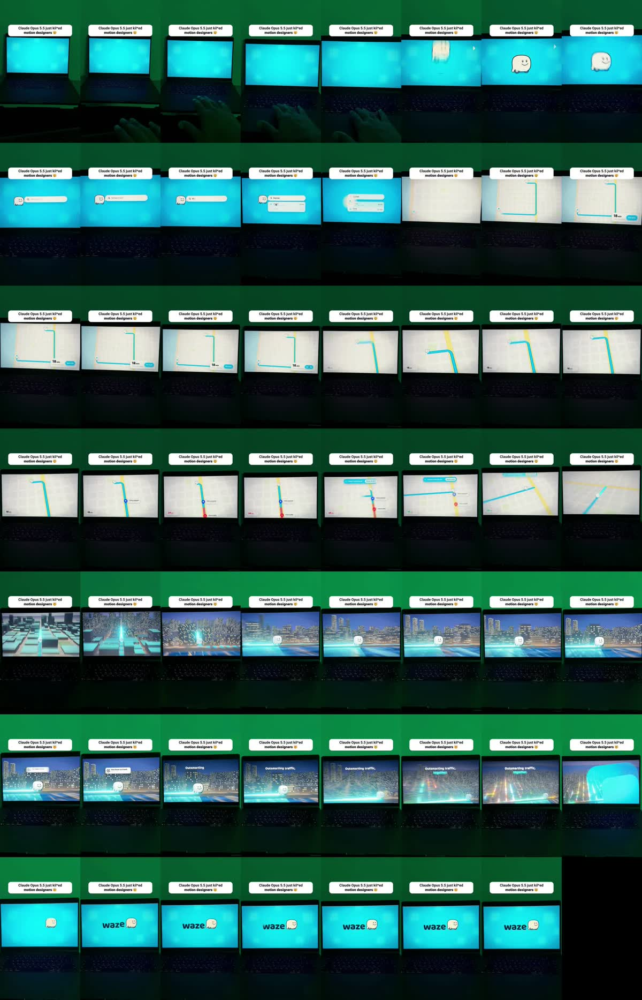

# R1: Koncept reklamy Waze, „natočená obrazovka“

| | |
|---|---|
| Odkaz | https://www.instagram.com/reel/DfFPgJOOt32/ |
| Autor | @ran_nuriani (tvůrce obsahu o AI) |
| Publikováno | 2026-10-29 |
| Metriky při analýze | 3 lajky, 32 komentářů (den po zveřejnění) |
| Formát | 1080×1920, 30 fps, 27,7 s |
| Zvuk | AI voiceover + hudba, −14,3 LUFS |
| Tvrdé střihy | 0 |
| Analyzováno | 2026-10-30 |



## Popisek
> Claude Opus 5.5 is doing motion design now. This Waze concept ad was made with it in Claude Code.
> Want the prompt? Comment PROMPT and I'll send it to your DMs 📩
> Spec ad, not affiliated with Waze.
> #opus #claude #motiondesign #aftereffects #ai

## Přepis
```
[ 2.3] Long day, let's get you home.
[ 4.3] Just type home and your route draws itself.
[ 7.3] 18 minutes, door to door.
[ 9.3] One tap and you're off.
[11.3] Up ahead, drivers spot the jam so you're rerouted live.
[14.3] And as night falls, block by block, the city lights up for you.
[18.3] And just like that, you're home.
[20.3] Outsmarting traffic. Together.
[24.3] Waze.
```

## Časová osa (přibližně)
| čas | obraz |
|---|---|
| 0–2,3 s | Ticho. Telefon pomalu najíždí na notebook ve tmě se zeleným světlem, ruka zmáčkne klávesu |
| 2,3–4 s | Logo maskota vyskočí („pop“ s pružinou) na tyrkysovém pozadí |
| 4–7 s | Vyhledávací pole, píše se „Home“, našeptávač |
| 7–11 s | Mapa, trasa se sama kreslí, štítek „18 min“, tlačítko Go |
| 11–14 s | Kamera sleduje trasu a naklání se do 3D, objeví se zácpa (červený úsek), trasa se živě přesměruje |
| 14–20 s | Plynulý přechod do 3D nočního města, budovy se rozsvěcují blok po bloku, notifikace „You have arrived“ |
| 20–24 s | Kinetický slogan „Outsmarting traffic, together.“ se světelnými pruhy |
| 24–27,7 s | Zoom do loga, end card „waze“ + maskot |

## Techniky
- **Formát „natočená obrazovka“**: animace se přehraje na notebooku a natočí telefonem ve tmě s barevným ambientním světlem. Působí opravdově („tohle je skutečné“), ne jako render.
- **Statický nadpis nahoře po celou dobu**: bílá zaoblená bublina, černé tučné písmo, emoji na konci. Text „Claude Opus 5.5 just kil\*ed motion designers 🤯“ má hvězdičku ve slově, aby obešel filtr algoritmu.
- **Celý příběh za 25 s**: problém (dlouhý den) → řešení (trasa) → komplikace (zácpa) → emoce (město se rozsvítí) → slogan → logo.
- **Žádný tvrdý střih**, všechno spojují pohyby kamery (2D mapa → 3D → město).
- **UI animace**: psaní do pole, kreslení trasy, notifikace.
- **CTA s klíčovým slovem**: „Comment PROMPT“ → automatická DM.
- **Právní pojistka u cizí značky**: „Spec ad, not affiliated with Waze.“

## Co si beru
P-formát „natočená obrazovka“, P-statický nadpis, P-příběhová struktura reklamy, P-přechody pohybem, P-CTA klíčovým slovem, P-disclaimer u cizích značek (viz `../pravidla-strihu.md`).
