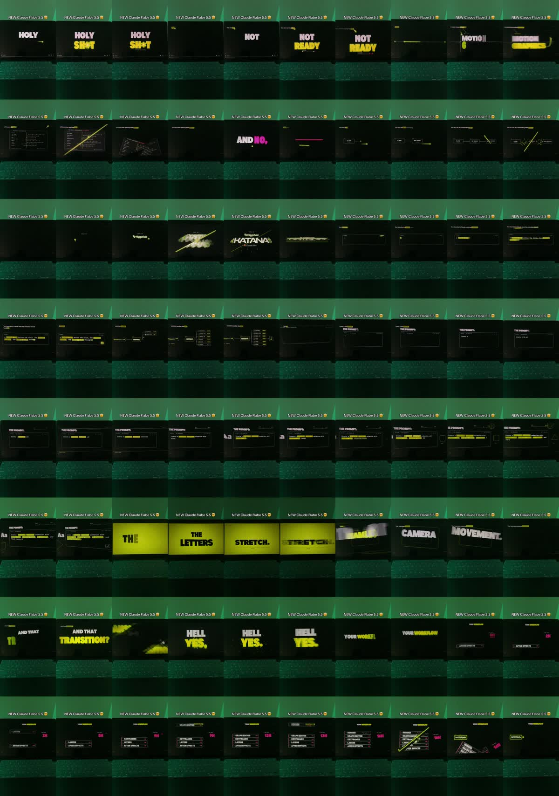

# R2: Higgsfield Katana, kinetická typografie + návod

| | |
|---|---|
| Odkaz | https://www.instagram.com/reel/DfA25yYktXw/ |
| Autor | @jasminsidehustles (placená spolupráce s @higgsfield.ai) |
| Publikováno | 2026-10-27 |
| Metriky při analýze | 18 070 lajků, 375 komentářů |
| Formát | 1080×1920, 30 fps, 75,1 s |
| Zvuk | lidský voiceover (rychlý, energický) + hudba, −14,1 LUFS |
| Tvrdé střihy | 54,1 / 57,8 / 61,7 / 65,6 s (jen v návodové části) |
| Analyzováno | 2026-10-30 |



## Popisek
> why isn't no one talking about this?? #sidehustle #onlinemoney #sandiego #higgsfieldpartner @higgsfield.ai

## Přepis
```
[ 0.0] Holy shit, you are not ready for this.
[ 3.6] I made these motion graphics without even opening After Effects.
[ 7.0] And no, this isn't an MCP controlling After Effects.
[10.3] This is Higgsfield Katana.
[12.8] You describe to Claude what the animation should look like. Katana handles the rest.
[17.5] I gave it this prompt. Create a 15 second cinematic animation with kinetic type,
       morphing shapes, 3D elements, and fluid camera moves.
[26.2] The way the letters stretch, that seamless camera movement. And that transition? Hell yes!
[32.9] So your workflow goes from After Effects, layers, keyframes, graph editor, render,
       to Katana, prompt, generate, render.
[42.2] And this entire piece you just watched, from the first idea to the final frame. One prompt, and that's it.
[49.4] Start off by going to higgsfield.ai/mcp … (návod v Claude: customize → přidat Higgsfield → vložit odkaz → /katana → vybrat preset)
[67.4] This is honestly a game changer… comment Katana and I'll send you the link plus a three day free trial.
```

## Časová osa (přibližně)
| čas | obraz |
|---|---|
| 0–3,6 s | HÁČEK: „HOLY SH\*T“ → „NOT READY“, obří tučný text slovo po slově, limetkově žlutá |
| 3,6–10 s | „MOTION GRAPHICS“ se roztahuje; „AND NO,“ růžově; schéma Claude → MCP → After Effects přeškrtnuté světelnou šmouhou |
| 10–12,8 s | Odhalení loga „Higgsfield KATANA“ se šmouhou a částicemi |
| 12,8–26 s | Okno s promptem, text se píše, klíčová slova zvýrazněná žlutým podkladem |
| 26–33 s | Celoplošná limetková plocha „THE LETTERS STRETCH.“ → „SEAMLESS“, „CAMERA MOVEMENT.“ s rozmazáním pohybem → „AND THAT TRANSITION?“ → „HELL YES.“ |
| 33–42 s | „YOUR WORKFLOW“: seznam After Effects → layers → keyframes → graph editor → render s počítadlem hodin 2H → 16H (růžově), pak přeškrtnutí → KATANA |
| 42–49 s | Pointa „one prompt“ |
| 49–67 s | Návod: záznamy obrazovky, tvrdé střihy po ~4 s, jeden krok = jeden záběr |
| 67–75 s | CTA „comment KATANA“ + 3 dny zdarma |

## Techniky
- **Silný háček v 1. sekundě**: šokující věta + obří text.
- **Kinetická typografie řízená hlasem**: každé slovo naskočí přesně s hlasem; klíčová slova mají jinou barvu nebo velikost.
- **Paleta**: černé pozadí + limetkově žlutá (hlavní akcent) + růžová (kontrast, „ne“, čísla).
- **Přechody**: diagonální světelná šmouha, rozmazání pohybem, roztažení písmen, glitch.
- **Před/po srovnání**: starý postup (seznam + rostoucí počítadlo hodin) vs. nový (1 krok). Velmi přesvědčivé.
- **Návodová část**: rychlé tvrdé střihy, každý krok ~4 s.
- **Formát „natočená obrazovka“** jako u R1 (zelené světlo, klávesnice v záběru) + statický nadpis nahoře „NEW Claude Fable 5.5 😎“.
- **CTA s klíčovým slovem** + bonus (zkušební verze zdarma).

## Co si beru
Háček do 1 s, kinetický text synchronizovaný s hlasem, 2 akcentní barvy, světelná šmouha jako přechod, před/po srovnání s počítadlem, návod po ~4 s krocích.
