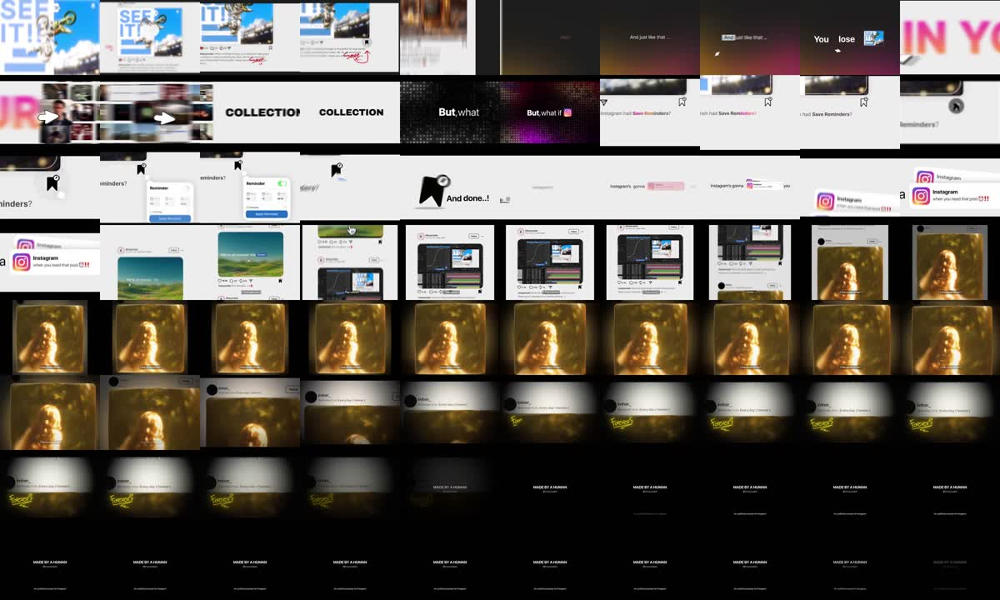

# R3: Koncept funkce „Save Reminders“ pro Instagram (MADE BY A HUMAN)

| | |
|---|---|
| Odkaz | https://www.instagram.com/reel/DfAcnNpsKy0/ |
| Autor | @mosycreate (motion designer) |
| Publikováno | 2026-10-27 |
| Metriky při analýze | **148 401 lajků, 2 612 komentářů**, nejúspěšnější z prvních pěti referencí |
| Formát | **1080×810 (4:3)**, 30 fps, 38,9 s |
| Zvuk | lidský voiceover + hudba, −14,3 LUFS |
| Tvrdé střihy | 0,1 / 4,5 / 6,6 / 8,0 s (jinak přechody pohybem) |
| Analyzováno | 2026-10-30 |



## Popisek (zkráceno)
> But what about her post? 👀
> Not a single bit of AI was used in this project. I've seen so much AI slop lately… I'm just happy I can still create stuff with my own hands 🙂
> I'm not an AI hater btw…
> Anyway, this is an unofficial Instagram feature concept, but I genuinely think we need this! What do you think? 👀

## Přepis
```
[ 0.0] See it, like it, save it, scroll, and just like that, you lose it in your huge collection.
[ 6.5] But what if Instagram had save reminders? Save a post, set a reminder, and done!
[12.2] Instagram's gonna notify you when you need that post, that reference, that tutorial,
[17.7] or that photo of her… forever.
```

## Časová osa (přibližně)
| čas | obraz |
|---|---|
| 0–4,5 s | Maketa IG příspěvku: „SEE IT!“, srdíčko, ručně psané poznámky („like it“, „save“ se šipkou), rychlý scroll s rozmazáním |
| 4,5–6,5 s | Gradientové pozadí (oranžová → růžová): „And just like that…“, „You lose“, obří „IN YOUR“, mřížka miniatur se rozmaže, „COLLECTION“ |
| 6,5–9 s | Tmavé tečkované pozadí: „But, what if [ikona IG]“ |
| 9–12 s | Světlá plocha: „Instagram had **Save Reminders**?“, ikona záložky s hodinami, panel Reminder (Apr / 15 / 09:00), „And done..!“ |
| 12–17 s | Notifikace „Instagram – when you need that post ⏰!!“, feed: that post / that reference / that tutorial (snímek After Effects) |
| 17–27 s | Emoční pointa: zlatá teplá fotka („that photo of her“), pomalý nájezd, „Reminder time: Every day (forever)“, ručně napsané „Forever“ |
| 27–39 s | End card na černé: „MADE BY A HUMAN @mosycreate / An unofficial concept for Instagram“, drží ~10 s |

## Techniky
- **Postoj a názor**: „bez AI, vyrobeno člověkem“ v době AI vlny. Polarizující téma, které vyvolává komentáře.
- **Vlastní koncept produktu** (fiktivní funkce známé aplikace) ukazuje design myšlení, nejen řemeslo.
- **Rychlý rytmus slov na začátku** („see it, like it, save it, scroll“), každé slovo = nový vizuál.
- **Mix stylů**, který drží pozornost: UI makety, velká typografie, gradienty, ručně psané anotace.
- **Emoční zvrat na konci** (z užitečné funkce na osobní vzpomínku) + zpomalení tempa a teplé světlo.
- **Dlouhý závěrečný podpis** (~10 s) dává čas na přečtení a video se smyčkuje.
- **Popisek končí otázkou** („What do you think?“) → 2,6 tis. komentářů.
- **Disclaimer**: „An unofficial concept for Instagram“.

## Co si beru
Emoční zvrat v závěru, ručně psané anotace pro lidský dojem, otázka v popisku, koncept vlastní funkce jako portfoliový formát, podpis/end card na konci.
