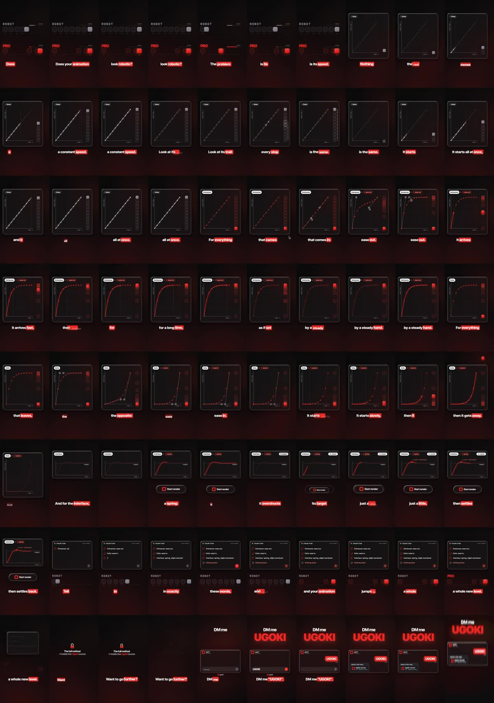

# R4: Proč animace vypadá roboticky (easing), vzdělávací video

| | |
|---|---|
| Odkaz | https://www.instagram.com/reel/De-LCYaRcC_/ |
| Autor | @ugoki.ai (kurz motion designu s AI) |
| Publikováno | 2026-10-26 |
| Metriky při analýze | 4 291 lajků, 144 komentářů |
| Formát | 1080×1920, **60 fps**, 48,5 s |
| Zvuk | lidský voiceover + hudba, −14,2 LUFS |
| Tvrdé střihy | žádné, vše je jedna souvislá animace |
| Analyzováno | 2026-10-30 |



## Popisek
> Want to learn AI-powered motion design? DM us UGOKI and we'll send you the link 🔥 #claude #motiondesign

## Přepis
```
[ 0.0] Does your animation look robotic? The problem is its speed.
[ 4.2] Nothing in the real world moves at a constant speed. Look at its trail. Every step is the same.
       It starts all at once, and it stops all at once.
[14.2] For everything that comes in, ease out. It arrives fast, then brakes for a long time,
       as if set down by a steady hand.
[23.4] For everything that leaves, the opposite. Ease in. It starts slowly, then it gets away.
[30.5] And for the interface, a spring. It overshoots its target just a little, then settles back.
[37.0] Tell Claude in exactly these words, and your animation jumps to a whole new level.
[43.2] Want to go further? DM me UGOKI.
```

## Časová osa (přibližně)
| čas | obraz |
|---|---|
| 0–4 s | Dva přepínače nad sebou: ROBOT (šedý, lineární) vs PRO (červený, s easingem), stejný pohyb vedle sebe |
| 4–14 s | Graf pozice/čas, lineární přímka, stopa bodů se stejnými rozestupy |
| 14–23 s | Karta „Entrances – ease out“: křivka strmě nahoru a pak dlouho dobržďuje |
| 23–30 s | Karta „Exits – ease in“: pomalý rozjezd, pak prudké zrychlení |
| 30–37 s | Karta „Interface – spring“: překmit nad cíl („slight overshoot“), tlačítko „Start render“, štítek „4× slower“ |
| 37–43 s | Okno Claude Code, píše se prompt (viz níže), přepínač se změní z ROBOT na PRO |
| 43–48,5 s | Zámek „The full method → inside the Ugoki course“, maketa DM chatu „UGOKI“, obří „DM me UGOKI“ |

## Prompt pro Clauda (doslova z videa)
```
Entrances: ease out.
Exits: ease in.
Interface: spring, slight overshoot.
Nothing linear.
```

## Techniky
- **Háček otázkou na bolest diváka** („Does your animation look robotic?“).
- **Titulky slovo po slově**: aktuální slovo má červený podklad (štítek), ostatní jsou bílá. Titulky jsou ve spodní třetině uprostřed.
- **Jednotný vizuální systém**: tmavé pozadí s červenou vinětou, karty se zaoblenými rohy a jemným okrajem, malé štítky, monospace popisky os.
- **Vysvětlení na vizualizaci** (graf + stopa bodů), ne jen slovy.
- **Srovnání vedle sebe** (ROBOT vs PRO) hned na začátku.
- **60 fps** kvůli plynulosti UI animací.
- **Okamžitě použitelný tip** (prompt), pak upsell: „chceš víc?“ → DM klíčové slovo.

## Co si beru
**Pravidla easingu, základ všech mých animací** (P-easing v pravidlech). Titulky slovo po slově se zvýrazněným aktivním slovem. 60 fps pro UI animace. Struktura vzdělávacího videa.
