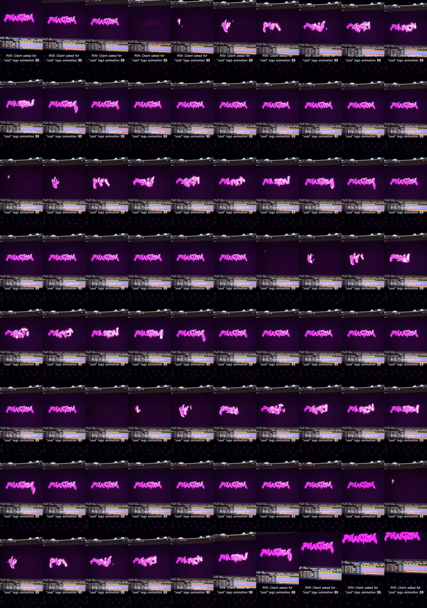

# R5: Logo animace „PHANTOM“ (neonové graffiti)

| | |
|---|---|
| Odkaz | https://www.instagram.com/reel/De8zUC1twcI/ |
| Autor | @kxjouanim (motion designer na zakázky) |
| Publikováno | 2026-10-26 |
| Metriky při analýze | 4 175 lajků, 250 komentářů |
| Formát | 1080×1920, ~60 fps, **10,6 s** |
| Zvuk | jen hudba (bez hlasu), −14,1 LUFS |
| Tvrdé střihy | žádné (jeden záběr monitoru) |
| Poznámka uživatele | „klidně takové loga na videa můžem dělat“ → **logo animace jsou v nabídce** |
| Analyzováno | 2026-10-30 |

## Popisek
> Need one? Open for commissions!👀
> Phantom typography smooth logo animation created in After Effects🔥
> #motiongraphics #motiondesign #aftereffects #logoanimation #animation

## Popis animace (jeden cyklus ≈ 3 s, ve videu proběhne 3×)
1. Na tmavě fialovém pozadí blikne jiskra.
2. Tahy písmen se kreslí (write-on) zleva doprava jako sprej nebo štětec, každý tah nechává zářivou stopu a jiskry.
3. Písmena „PHANTOM“ (graffiti / brush písmo, neonově růžová s bílým jádrem a silnou září) se usadí.
4. Krátce drží, lehce dýchá (glow pulzuje), pak zmizí a cyklus začíná znovu.
5. Poslední ~1 s kamera najede blíž a logo je větší.

## Techniky
- **Natočený monitor s otevřeným After Effects** (časová osa vidět dole): ukazuje proces a řemeslo, působí autenticky.
- **Text „POV: Client asked for "cool" logo animation 👀“**: vtipná, sdílitelná situace z praxe, bílý text se stínem uprostřed dole.
- **Krátké video + opakování animace** → vysoká retence, divák se dívá víckrát.
- **Paleta**: 1 neonová barva + tmavé pozadí ve stejném odstínu; záře (glow) je hlavní efekt.
- **CTA pro zakázky**: „Need one? Open for commissions“.

## Jak to udělám já
- Potřebuju logo **ve vektoru** (SVG / AI / PDF). Z obrysů písmen udělám kreslení tahů přes masky, záři, jiskry a částice (Remotion / ffmpeg).
- Ručně animované tahy štětcem z After Effects budou v mém podání jednodušší, ale efekt kreslení + neonové záře se dá napodobit věrně.
- Výstup: 9:16 i 1:1, smyčka 3–4 s opakovaná 3× (≈ 10 s), verze s průhledností (pro použití na začátku/konci videí).

## Co si beru
Logo animace jako služba, smyčka v krátkém videu, „POV“ text, ukázat proces (software), záře jako hlavní efekt, 1 neonová barva.
