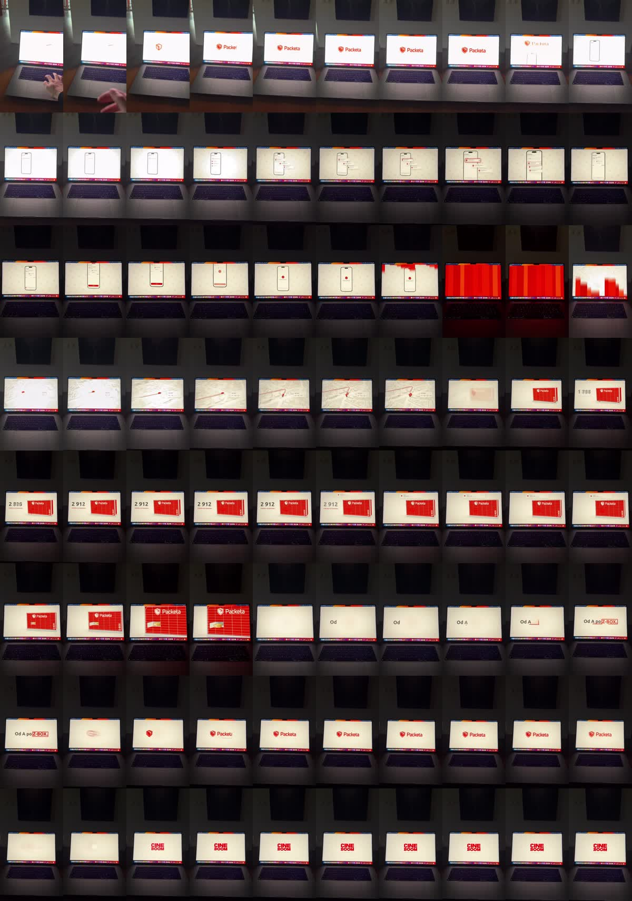

# R6: Packeta Z-BOX, spec reklama „natočená obrazovka“ (rozbor střihu po snímcích)

| | |
|---|---|
| Odkaz | https://www.instagram.com/reel/DfNC4_jAe3g/ |
| Autor | @davidxsipos (David Sipos), end card „CINE BOOM“ = značka tvůrce |
| Publikováno | 2026-11-01 (menu bar v obraze: „Sun 1 Nov 16:09“) |
| Metriky při analýze | 186 lajků, 14 komentářů (3 dny po zveřejnění) |
| Formát | 1080×1920, 60 fps, 22,2 s (1333 snímků) |
| Zvuk | slovenský voiceover (AI nebo studiový hlas), téměř bez hudby; −14,1 LUFS, LRA 7,1 LU |
| Tvrdé střihy | **0** (jediný záběr telefonem, všechny změny jsou uvnitř animace na displeji) |
| Analyzováno | 2026-11-04 (analytik, zadání režiséra po zpětné vazbě k V004) |



Poslal uživatel jako první ze tří předloh: „zkus se zaměřit víc na ten střih a editaci videa… adaptuj se na tyhle střihy.“
Pásy snímků z výřezu displeje: `media/reference/R6-packeta-zbox/pasy/` (`pas_025s.jpg` = celé video po 0,25 s, `husty_*.jpg` = po 3 snímcích kolem každého přechodu).

## Popisek
> @packeta.sk

(Nic víc. Disclaimer je až v obraze na end card: „Spec ad · bez väzby na Packeta Slovakia“.)

## Přepis (opravený podle obrazu, časy slov z Whisper medium `--jazyk sk`)
```
[ 0.43- 2.89] Čokoľvek si objednáte,          (Čokoľvek 0,43–1,39 · si · objednáte 1,55–2,89)
[ 3.29- 4.71] stačí si vybrať Z-BOX.          (stačí 3,29 · vybrať 3,75 · Z-BOX 4,15–4,71)
[ 5.77- 8.23] Jedno ťuknutie a balík je už na ceste.   (ťuknutie 5,99–6,65 · balík 7,05 · ceste 7,83–8,23)
[10.57-12.59] Do Z-BOXu kúsok od vás.         (Do 10,57 · Z-BOXu 10,75–11,65 · kúsok 11,65 · vás 12,17–12,59)
[12.95-15.23] Vyzdvihnite si ho, kedy sa vám hodí.     (Vyzdvihnite 12,95–13,61 · kedy 14,07 · hodí 14,65–15,23)
[15.35-17.17] Od A po Z-BOX.                  (Od 15,35 · A 15,57–16,17 · po 16,17 · Z-BOX 16,45–17,17)
[17.97-18.39] Packeta.
```
Whisper (small, cs) komolil: „zetboks“ = Z-BOX, „Paketa“ = Packeta, „tuknutě“ = ťuknutie. Mezi větami jsou pauzy 0,4–2,3 s, v nich jen animace.

## Časová osa (po prvcích, časy z pásů snímků, 60 fps)
<!-- OSA -->

## Střihová partitura
<!-- PARTITURA -->

## Kamera a prezentace
<!-- KAMERA -->

## Typografie a čísla
<!-- TYPO -->

## Zvuk
<!-- ZVUK -->

## Srovnání s naším V004
<!-- V004 -->

## Techniky
<!-- TECHNIKY -->

## Co to znamená pro naše videa
<!-- ZNAMENA -->

## Co si beru
<!-- BERU -->
