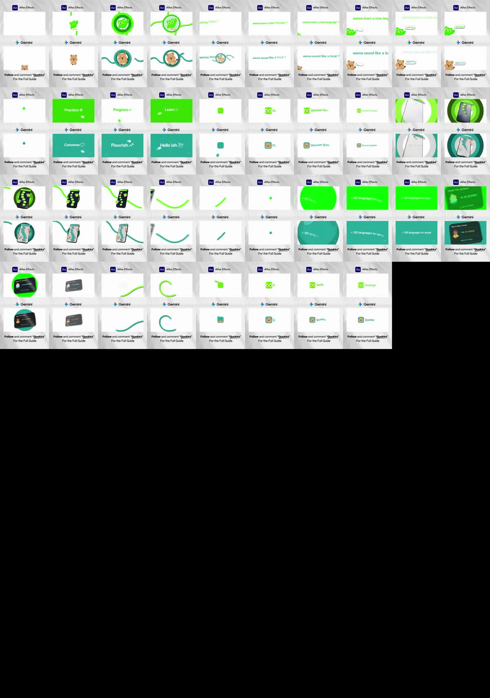

# R7: „After Effects vs Gemini“, srovnání dvou animací (Duolingo / Quokka) na rozdělené obrazovce

| | |
|---|---|
| Odkaz | https://www.instagram.com/reel/DfGkxZ9oTaB/ |
| Autor | @shhradddhaa.ai (Shraddha, tvůrkyně obsahu o AI) |
| Publikováno | 2026-10-30 |
| Metriky při analýze | 4 113 lajků, **3 607 komentářů** (5 dní po zveřejnění; komentáře ≈ 88 % lajků = CTA klíčovým slovem) |
| Formát | 1080×1920, **24 fps**, 9,55 s (229 snímků); uvnitř dva panely 16:9 (920×517 px) pod sebou |
| Zvuk | vokální sample „Hey! Just want to feel it!“ + hudební podklad, silně komprimovaný (LRA 1,1 LU), −14,1 LUFS |
| Tvrdé střihy | **0** (scdet hlásí 2,625 s, to je ale tečka, která exploduje do zelené plochy, ne střih) |
| Analyzováno | 2026-11-04 (analytik, zadání režiséra po zpětné vazbě k V004: „zaměř se na střih a editaci“) |



Třetí ze tří předloh od uživatele (R6 Packeta, R7 tohle, R4 znovu). Pásy snímků: `media/reference/R7-quokka-srovnani/pasy/`
(`pas_025s.jpg` = celé video po 0,25 s, `husty_000/080/160.jpg` = **každý snímek** 0–3,3 / 3,3–6,6 / 6,6–9,5 s, `detail_A/B/C.jpg` = klíčové snímky v plném rozlišení).

## Popisek
Instagram popisek yt-dlp nevrátil (`description: None`). CTA je přímo v obraze, staticky po celou dobu:
> **Follow** and comment “**Quokka**”
> For the Full Guide

## Přepis
```
[ 0.00- 0.50] Hey!
[ 0.50- 1.70] Just want to feel it!
```
Není to voiceover, ale **vokál v hudbě** (spektrogram ukazuje zpěvové harmonické i po 1,7 s, bez slov). Nic z obrazu se nečte hlasem.

## Rozložení obrazu (9:16, změřeno na snímku 66)
| prvek | poloha (px) | poznámka |
|---|---|---|
| pozadí | celé | světle šedá `#efefef` s měkkými stíny listů (fototapeta „slunce oknem“), panely mají vlastní stín |
| štítek „Ae After Effects“ | y ≈ 160, vlevo od x = 115 | logo + název nástroje, černé písmo |
| panel 1 (AE, originál) | x 80–1000, y 260–777 | 920×517 = 16:9, bílé pozadí animace |
| štítek „✦ Gemini“ | y ≈ 940 | |
| panel 2 (Gemini, replika) | x 80–1000, y 1022–1539 | 920×517 |
| CTA | y 1624–1695, x 103–989 | 2 řádky, tučně „Follow“ a „Quokka“ (podtrženo), 225–295 px od spodního okraje = v naší spodní zóně A5 (autor to riskuje) |

Každý panel je tedy **16:9 animace vložená do 9:16 mockupu** (A7: přeskládat, ne oříznout). Hrdina (panel) zabírá 85 % šířky.

## Časová osa (horní panel AE; dolní Gemini je stejná ±1 snímek, rozdíly níže)
Časy ze snímků (24 fps, snímek f → f/24 s). „Scéna“ = kompoziční celek, který divák vnímá jako jeden obraz.

| čas | scéna | co se děje |
|---|---|---|
| 0,00–0,13 | (prázdno) | 3 snímky prázdný bílý panel; snímek 0 **není** hotový obraz animace, ale mockup s CTA je |
| 0,13–1,00 | **1 maskot v kruhu** | sova vyskočí zdola (pop s pružinou, squash), z ní vyroste svislá čára, čára se obtočí do kruhu s prstenem, prsten se „rozmotá“ do dvou S-křivek, sova i kruh vyblednou |
| 1,00–2,17 | **2 otázka** | S-křivky odjíždějí, „wanna learn a new language ?“ slovo po slově (každé z jiné výšky), klid 0,42 s, text se zvětšuje a ujíždí vpravo, vybledne |
| 1,63–2,42 | **2b maskot + bublina** | sova vykoukne zleva dole, bublina „I got you“ (pop), bublina se natáhne do pilulky, sova odjede dolů se šmouhou |
| 2,42–2,62 | spojka | zelená tečka spadne shora (šmouha), dosedne do středu |
| 2,63–3,46 | **3 tři karty** | tečka exploduje do zelené plochy „Practice ⚙“ (0,33 s) → bílá plocha „Progress ↗“ (0,21 s) → zelená „Learn ⌂“ (0,29 s); přes plochu letí měkký světelný blob |
| 3,46–4,46 | **4 ikona + název** | bílý kruh ze středu smaže plochu (2 snímky), z jeho středu vyroste zaoblený čtverec (pružina), dokreslí se obličej, „Discover Duolingo“ po písmenech (0,42 s), celek se zmenší do dálky a vybledne |
| 4,46–5,79 | **5 telefon** | bílý telefon vjede z pravého horního rohu v 3D náklonu se šmouhou, soustředné zelené kruhy rostou od okrajů, displej se „zapne“ (tmavé UI s cestou lekcí a sovou), zelený tah se prožene zleva za telefon, kruhy zmizí, telefon se pomalu natáčí 0,42 s, pak odletí vlevo nahoru s echem snímků (2 snímky) |
| 5,79–6,33 | spojka | zůstane jen tah, zatáhne se od obou konců do tečky (0,42 s) |
| 6,33–7,17 | **6 tvrzení** | tečka naroste do zelené plochy (4 snímky), „+ 100 languages to learn“ po písmenech (každé spadne z výšky, 0,42 s), klid 0,17 s, text se rozmaže |
| 7,21–7,96 | **7 UI karta** | tmavá karta „Speak this sentence · Mi BOMBO · TAP TO SPEAK“ přiletí zoomem z obřího měřítka (šmouha), dosedá 3D náklonem, zelená plocha se smrští do kruhu za kartou a zmizí, karta chvíli stojí na bílé, zešedne a vybledne |
| 7,92–8,50 | spojka | zprava vjede tah, nakreslí vlnu, stočí se do „C“ |
| 8,50–9,42 | **8 logo** | konec tahu se stane čtvercem ikony (pružina), dokreslí se obličej, „Duolingo“ po písmenech (0,38 s), klid 0,17 s |
| 9,42–9,55 | konec | vše vybledne do bílé → navazuje na snímek 0 (**smyčka bílá → bílá**) |

**Rozdíly dolního panelu (Gemini)**: quokka místo sovy, tyrkys `#1a9a8c` místo zelené; quokka v kruhu je fotorealistická samolepka, ne vektor;
tři karty jsou **všechny tyrkysové** (AE střídá zelená / bílá / zelená = inverze), tedy replika ztratila jeden rytmický nápad; texty „wanna sound like a local ?“,
„Hop on in“, Converse / Flourish / Hello ish, „+ 120 languages to speak“, karta „Say it like a local · Mi AMIGO · HOLD TO TALK“, logo „Quokka“.
Časování obou panelů se liší nejvýš o 1 snímek (Flourish 2,92 vs Progress 2,96): obě animace běží ze stejné časové osy, replika kopíruje i časy.

## Střihová partitura
Každý prvek obrazu: kdy a jak přijde, jak dlouho stojí, kdy a jak odejde, co ho spojuje s dalším. Časy na 2 desetinná místa (snímek/24).
„klid“ = doba, kdy prvek stojí na místě (vždy s mikropohybem: natáčení, blob, dýchání).

| # | prvek | příchod | typ příchodu | klid | odchod | typ odchodu | spojka s dalším |
|---|---|---|---|---|---|---|---|
| 1 | sova (maskot) | 0,13–0,38 | pop zdola, pružina se squashem (3 snímky překmit, cca 8 %) | 0,38–0,83 (0,45 s) | 0,83–0,96 | vybledne pod bílým překryvem | ze sovy vyroste **svislá čára** (0,33) |
| 2 | prsten kolem sovy | 0,42–0,50 | čára se obtočí do kruhu (2 snímky), plná výplň + tmavší prsten | 0,50–0,83 | 0,83–0,96 | prsten se **rozmotá** do dvou S-křivek | křivky jsou „tužka“, která odjíždí a uvolňuje místo textu |
| 3 | S-křivky | 0,67–1,00 | vyrostou z prstenu doleva nahoru a doprava dolů | – | 1,00–1,13 | odjedou z obrazu po své dráze | končí přesně, když přistává první slovo |
| 4 | „wanna learn a new language ?“ | 1,00–1,21 | **slovo po slově** (5 slov za 5 snímků), každé z jiné výšky, fade + ease-out | 1,25–1,63 (0,38 s) | 1,67–2,17 | zvětšení 1,0 → ~1,4 (kamera přijíždí), text ujíždí vpravo, vybledne | zvětšení uvolní spodní levý roh pro sovu |
| 5 | sova 2 | 1,63–1,75 | vykoukne zleva dole (ease-out) | 1,75–2,33 | 2,38–2,42 | odjede dolů se směrovou šmouhou, 1 snímek | – |
| 6 | bublina „I got you“ | 1,79–1,88 | pop s pružinou | 1,88–2,33 (0,45 s) | 2,38–2,42 | **natáhne se do pilulky** (text rozmazán), pilulka 1 snímek bílá, zmizí | pilulka → tečka (stejná barva, stejná „hmota“) |
| 7 | tečka | 2,42–2,58 | spadne shora se svislou šmouhou, dosedne do středu (ease-out) | 1 snímek | 2,63 | **exploduje do plochy** (1 snímek) | tečka = zárodek karty Practice |
| 8 | karta „Practice ⚙“ (zelená plocha, bílý text) | 2,63 | plocha naráz, text naráz | 0,33 s (světelný blob letí zprava doleva) | 2,92–2,96 | text fade (2 snímky), plocha se **invertuje** | inverze = střih bez střihu |
| 9 | karta „Progress ↗“ (bílá, zelený text + tečka) | 2,96 | naráz | 0,21 s | 3,13–3,17 | fade | inverze zpět |
| 10 | karta „Learn ⌂“ (zelená) | 3,17 | naráz | 0,29 s | 3,46–3,50 | **bílý kruh ze středu** smaže plochu (2 snímky, měkký okraj) | střed kruhu = střed ikony |
| 11 | ikona (zaoblený čtverec) | 3,50–3,63 | vyroste ze středu kruhu, pružina se squashem | 3,67–4,25 | 4,29–4,46 | zmenší se „do dálky“ + fade, spolu s textem | zmenšení otevírá prostor telefonu |
| 12 | obličej v ikoně | 3,67–3,79 | dokreslí se (oči, zobák) po částech | – | s ikonou | – | – |
| 13 | „Discover Duolingo“ | 3,83–4,21 | **po písmenech** (17 znaků / 10 snímků), písmena přilétají zprava do řady | 4,21–4,29 (0,08 s) | 4,29–4,46 | s ikonou | – |
| 14 | telefon (bílý, 3D) | 4,46–4,67 | vjede z pravého horního rohu, velký, naklonění ~25°, šmouha, ease-out | 4,67–5,71 (natáčí se) | 5,75–5,79 | odletí vlevo nahoru, **echo snímků** (4–5 kopií), 2 snímky | tah za telefonem zůstane |
| 15 | soustředné kruhy | 4,50–4,75 | rostou od okrajů panelu dovnitř (3 odstíny zelené) | 4,75–5,08 | 5,08–5,17 | smrsknou se do telefonu | – |
| 16 | displej (UI s cestou lekcí) | 4,83 | **zapne se naráz** (bílá → tmavé UI), 1 snímek | do odchodu telefonu | – | – | samolepky sovy na displeji pulzují |
| 17 | tah 2 (za telefonem) | 5,17–5,29 | prožene se zleva doprava dolů, zůstane jako vlna | 5,29–5,83 | 5,88–6,29 | **zatahuje se od obou konců** do tečky (0,42 s, ease-in) | tečka 2 |
| 18 | tečka 2 → plocha | 6,33–6,50 | tečka naroste do celé plochy (4 snímky, ease-in) | – | – | – | plocha = pozadí tvrzení |
| 19 | „+ 100 languages to learn“ | 6,54–6,96 | **po písmenech**, každé spadne shora na základní linku (vlna zleva doprava) | 6,96–7,13 (0,17 s) | 7,17–7,21 | rozmazání + fade | karta přilétá přes rozmazaný text |
| 20 | karta „Mi BOMBO“ (tmavé UI) | 7,21–7,46 | zoom z ~3× s rozmazáním (ease-out), dosedne 3D náklonem | 7,46–7,83 | 7,83–7,96 | **zešedne** (desaturace) a vybledne | zprava už vjíždí tah 3 |
| 21 | zelená plocha za kartou | – | (z #18) | – | 7,50–7,63 | **smrští se do kruhu** za kartou a zmizí (3 snímky) | kruh = ozvěna kruhu z #10 |
| 22 | tah 3 (vlna → C) | 7,92–8,46 | vjede zprava, kreslí vlnu, stočí se do „C“ | – | 8,50 | konec tahu **je** ikona | stejný tah jako #3 a #17, stejná barva |
| 23 | ikona 2 + obličej | 8,50–8,63 | vyroste z konce tahu, pružina | 8,63–8,79 | 9,42–9,55 | fade do bílé | → snímek 0 (smyčka) |
| 24 | „Duolingo“ | 8,83–9,21 | po písmenech | 9,21–9,38 (0,17 s) | 9,42–9,55 | fade do bílé | – |

**Vzorce, které se opakují**
- **Jedna spojovací hmota**: tah / tečka / kruh / plocha v barvě značky. Tečka ↔ plocha (2,63; 6,33), tah ↔ ikona (0,33; 8,50), tah → tečka (6,29), bublina → pilulka → tečka (2,38–2,50). Prvky nemizí, **mění se v další prvek**.
- **Příchod rychlý, odchod ještě rychlejší**: příchody 3–6 snímků (0,13–0,25 s), odchody 1–3 snímky (0,04–0,13 s). Výjimka: fade končící scény 3–4 snímky, zatažení tahu 10 snímků.
- **Klid 0,17–0,45 s** u všeho, co má divák přečíst; nikdy přes 0,45 s bez změny.
- **Tři způsoby „střihu“ bez střihu**: (a) explozí tečky do plochy, (b) kruhovou clonou ze středu, (c) inverzí barvy plochy. Nikde prolínačka dvou scén.
- **Šmouha jen na odchodu a u nárazu**: odchod sovy (1 snímek), pád tečky, odlet telefonu (echo snímků), zoom karty. Statický text vždy ostrý.
- **Text po znacích bez hlasu**: 4× (slova 1,00; písmena 3,83; 6,54; 8,83), vždy 0,38–0,42 s na celý řádek, pak ≥ 0,08 s klid.

## Čísla střihu
- Délka 9,55 s, **0 tvrdých střihů**, **8 scén** + 3 spojky → změna scény každých **~0,87 s** (scény 0,84–1,33 s, spojky 0,2–0,54 s).
- **24 prvků na panel** (×2 panely) → **2,5 prvku/s**; událostí (příchod + odchod + proměna) **≈ 50 na panel = 5,2 za sekundu**.
- Nejdelší úsek bez nové události: 0,45 s (sova v kruhu; telefon se natáčí 0,42 s). Žádná „mrtvá“ pasáž.
- Karty 3 slov: 8 / 5 / 7 snímků = 0,33 / 0,21 / 0,29 s (nepravidelně, zrychlení k pointě).
- Smyčka: konec = bílá (9,42–9,55 fade), začátek = bílá (0–0,13): spoj je neviditelný; proto video jede ve smyčce a sbírá zhlédnutí.

## Zvuk a vazba střihu na zvuk
- Podklad: vokální sample „Hey! Just want to feel it!“ (0–1,7 s) + hudba se zpěvovými harmonickými po celou dobu, bas, transientní whooshe.
  Silně komprimované (LRA 1,1 LU), −14,1 LUFS. Jediné zřetelné ztišení: **3,0–3,3 s** (−31 dB proti průměru −20 dB) = pod bílou kartou „Progress“, před návratem zelené = krátký nádech.
- **Tempo**: autokorelace nástupů dává 112 BPM (perioda 0,535 s) slabě; pravidelná mřížka sedí na obrazové události nejhůř (nejlepší 135 BPM: 20 z 34 událostí ±2 snímky,
  to je na úrovni náhody). **Střih nejede na dobách.**
- **Vazba na nástupy zvuku** (38 nástupů změřeno z obálky 40 Hz–8 kHz): 19 z 34 obrazových událostí sedí ±2 snímky. Velké události sedí přesně
  (Δ ≤ 0,04 s): Practice 2,63 · Progress 2,96 · Learn 3,17 · telefon 4,46 · displej 4,83 · zatažení tahu 6,00 · tečka 6,33 · kruh za kartou 7,50 · „C“ 8,17 · ikona 8,50 · fade 9,42.
  Malé události (pop sovy 0,17, bublina → pilulka 2,38, odlet telefonu 5,75, vjezd tahu 7,92, typing 8,83) **vlastní zvuk nemají**.
- Závěr: **rytmus určuje animace** (vizuální logika proměn), zvuk je souvislý podklad + ~10 akcentů na největší proměny. Opak našeho V004, kde mřížka 120 BPM určovala každý střih.

## Kamera a prezentace
- **Kamera uvnitř panelu**: prakticky statická; jediný pohyb kamery je zvětšení textu 1,67–2,17 (nájezd ~1,4×) a zmenšení ikony „do dálky“ 4,29–4,46. Hloubku dělají prvky (3D telefon, zoom karty z 3×), ne kamera.
- **Prezentace = mockup**: šedé pozadí s měkkými stíny listů, dva panely 16:9 se stínem, štítek nástroje nad každým, CTA pod nimi. Divák porovnává **dvě verze téhož** (originál vs replika) a sám hledá rozdíly, což drží pozornost celých 9,5 s (a nutí přehrát znovu).
- Panel je **jeden svět, jedna barva** (zelená `#58cc02`-ish / tyrkys), bílé pozadí; žádná paleta navíc kromě tmavé UI karty a oranžových nohou sovy.

## Typografie
- Jedno zaoblené bezpatkové písmo (Duolingo styl „Feather Bold“-like) ve dvou řezech; v panelu nikdy víc než **1 řádek textu**.
- Otázka: 5 slov, **slovo po slově** z různých výšek (0,21 s); tvrzení a názvy: **po písmenech** s pádem na linku (0,38–0,42 s). Vždy bez hlasu (odporuje našemu E1).
- Text nikdy nesdílí plochu s jiným textem: název se objeví až po usazení ikony, tvrzení až po naplnění plochy.
- Bez tečky na konci, otazník s mezerou („language ?“). Verzálky jen v UI kartě („TAP TO SPEAK“).

## Proč 3 600 komentářů
1. **CTA klíčovým slovem v obraze** („comment Quokka“ → DM s návodem), ne jen v popisku; slovo je podtržené a tučné, celých 9,5 s na místě. Poměr komentářů k lajkům 0,88 (R1 ~10, běžně 0,02–0,05).
2. **Formát srovnání**: „After Effects vs Gemini“ = spor „nahradí AI designéra?“ → lidé komentují i názor, ne jen klíčové slovo.
3. **Krátká smyčka** (9,5 s, bílá → bílá): video se přehraje víckrát, než divák dočte CTA; každé přehrání se počítá.
4. **Hustota**: 5 událostí za sekundu nedá prostor ke scrollu; první pop do 0,2 s.
5. Známá značka (Duolingo) + roztomilý maskot (quokka) = emoce a sdílení bez vysvětlování.

## Co je to za formát
Ukázka „AI (Gemini) zreplikovala animaci z After Effects s jinou značkou“. Hlavní obsah je **animace sama**, formát (mockup, štítky, CTA) je obal.
Pro uživatele je podstatné obojí:
- **Střih animace**: jeden spojovací jazyk (tah / tečka / kruh / plocha), proměny místo střihů, rychlé příchody a ještě rychlejší odchody, klid jen na čtení, text po znacích.
- **Prezentace**: hotové video se ukazuje **v mockupu s popiskem a CTA**, ne nahé; 16:9 práce jde do 9:16 jako panel. Dvojice panelů (před/po, originál/replika, 2 varianty) je formát,
  který se dá použít i u našich videí (např. „Zadání / Výsledek“, „Reference / Naše verze“, „V1 / V4“).
- Uživatelova prezentace portfolia: vlastní videa v tomto obalu = jedna šablona mockupu (pozadí, stíny, štítek, CTA) a pak jen vyměnit panel.

## Srovnání s naším V004 (BMW i7)
| | R7 | V004 |
|---|---|---|
| délka, formát | 9,5 s, 9:16 s 16:9 panely, 24 fps | 30 s, 16:9, 60 fps |
| tvrdé střihy | 0 | ~25 (střihy na doby a čtvrtdoby) |
| co spojuje záběry | **jedna hmota značky** (tah, tečka, kruh, plocha), která se mění v další prvek | bod → linka → karta (podobné!), ale mezi záběry jízdy jsou tvrdé střihy a švihy |
| rytmus | nepravidelný, určený animací (5 / 7 / 8 snímků), zvuk jde za obrazem | mřížka 120 BPM, obraz jde za hudbou |
| změna scény | každých 0,87 s, všechno uvnitř jednoho světa | každé 2 s takt, uvnitř taktu střihy po 0,5 s |
| příchod / odchod | 0,13–0,25 s / 0,04–0,13 s | karty pružina ~0,3 s, odchod „do bodu“ ~0,25 s |
| klid | 0,17–0,45 s, nikdy víc | ≥ 0,5 s (G9), karty i 1 s |
| text | 1 řádek, po znacích, 0,4 s na řádek | karty s popiskem + rolující číslo + jednotka, 3 úrovně |
| kamera | statická, hloubka prvky | dotlačení 1,00 → 1,04, průlety, punch-in |
| svět | 1 barva + bílá, plochá vektorová grafika | realistická stopáž + rendry + UI vrstva |
| hustota událostí | 5,2 / s | ~2 / s (událost na dobu) |
| konec | 0,13 s logo + fade do bílé, smyčka | end card 4 s |

V čem je střih R7 jiný, a co z toho jde použít i u realistického auta: (1) **proměna místo střihu** tam, kde střih nic nepřidává (UI a grafické vrstvy),
(2) **odchody kratší než příchody** (u nás jsou stejně dlouhé nebo delší), (3) **spojovací hmota** stejné barvy, která nikdy nezmizí, jen se mění (náš bod to dělal jen částečně,
mezi scénami se ztrácel), (4) **hustota** bez mrtvých míst: žádný prvek nestojí déle, než je potřeba ho přečíst, (5) **rytmus z obrazu**, hudba a SFX se dodělají podle hotového obrazu
(což jsme ve V004 stejně nakonec dělali, C045). Co nepřebírat: 24 fps, statická kamera (vkus uživatele chce pohyb), snímek 0 prázdný.

## Techniky
- **Pop s pružinou a squashem** (3 snímky překmit, ~8 %): maskot 0,13, bublina 1,79, ikona 3,50 a 8,50. Hravý svět, překmit větší než naše 3 % (F4 to u postav dovoluje).
- **Tah jako tužka**: čára vyroste z prvku, kreslí kruh / vlnu, její konec se stane dalším prvkem (ikona). Tloušťka ~24 px při 920 px šířce, zaoblené konce, měkký stín.
- **Tečka → plocha** (exploze 1 snímek) a **plocha → kruh → nic** (3 snímky) jako střih.
- **Kruhová clona ze středu** s měkkým okrajem (2 snímky) a nový prvek roste přesně ze středu clony.
- **Inverze barvy plochy** mezi kartami (zelená / bílá / zelená) = tři karty bez jediného pohybu, a přesto jsou to tři údery.
- **Odchod se šmouhou**: sova 1 snímek dolů, telefon 2 snímky s echem snímků (vícenásobné kopie: v kódu = podsnímky s delší závěrkou).
- **Text po znacích s pádem na linku** (bez hlasu): ~1,7 znaku na snímek.
- **Zoom karty z 3× s rozmazáním** (ease-out) + dosednutí 3D náklonem; odchod desaturací (karta „zhasne“) a fade.
- **3D telefon**: vjezd z rohu, displej se zapne naráz, pomalé natáčení v klidu, soustředné kruhy jako „vlna“ od okrajů.
- **Mockup**: šedá fototapeta se stíny listů, panely se stínem, štítek nástroje, CTA ve 2 řádcích, tučné klíčové slovo podtržené.

## Co to znamená pro naše videa
1. **Spojovací hmota značky** (barva + tvar: tah / tečka / kruh / plocha) jako jediný „lepidlo“ celé grafické vrstvy: nikdy nezmizí, vždy se promění v další prvek.
   U auta = bod / linka / karta (V004) dotáhnout tak, aby bod přežil i přes tvrdé střihy jízdy (zůstane v obraze, změní polohu podle vozu, na střihu ho střih nezruší).
2. **Odchody 1–3 snímky**, příchody 3–6 snímků (při 60 fps 2–8 / 8–15 snímků). Odcházející prvek se **natáhne / smrští / zešedne** do podoby dalšího prvku, nemizí fade.
3. **Klid jen na přečtení**: 1 slovo 0,2–0,33 s, řádek 0,4 s + 0,1–0,2 s; nic nestojí přes 0,45 s bez proměny (u čísel platí dál G9 ≥ 0,5 s, protože číslo se musí ověřit).
4. **Tři střihy bez střihu** do zásobníku: exploze tečky do plochy, kruhová clona ze středu (nový prvek roste ze středu), inverze barvy plochy mezi po sobě jdoucími kartami.
5. **Text po znacích i bez hlasu**, když je to název nebo tvrzení v barvě značky (0,4 s na řádek, pád na linku). Úprava E1.
6. **Zvuk až podle obrazu**: rytmus určuje animace, SFX sedí jen na velké proměny (~1 za sekundu), hudba je podklad. Potvrzuje postup z V004 (obraz → potom zvuk).
7. **Prezentace v mockupu**: hotová videa (i 16:9) ukazovat v 9:16 obalu: šedé pozadí s měkkým stínem, panel se stínem, štítek, CTA s klíčovým slovem v obraze.
   Dvojice panelů (reference / naše verze, před / po) jako formát pro portfolio a pro získání komentářů.
8. **Smyčka bílá → bílá** u krátkých ukázek (≤ 10 s): poslední snímek a první snímek stejná prázdná plocha, obal (mockup, CTA) zůstává = divák nevidí spoj.

## Co si beru
P-spojovací hmota značky (tah / tečka / kruh / plocha), P-odchod kratší než příchod a vždy proměnou, P-klid jen na přečtení, P-tři střihy bez střihu (exploze tečky, kruhová clona,
inverze plochy), P-text po znacích bez hlasu u názvů a tvrzení, P-rytmus z obrazu a zvuk podle obrazu, P-mockup s CTA v obraze, P-smyčka bílá → bílá (viz `../pravidla-strihu.md`,
pravidla doplní režisér po všech rozborech).
